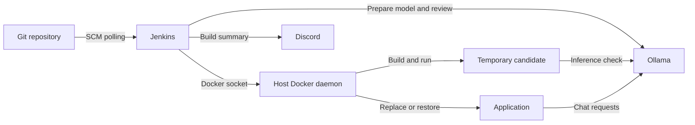

# Architecture and pipeline decisions

[README](../README.md) · English · [Português (Brasil)](pt-BR/architecture.md)

The [Jenkinsfile](../Jenkinsfile) coordinates tests, advisory review, and deployment of a Node.js API. [Compose](../compose.yaml) runs Jenkins, Ollama, and the application on the same Docker host.

## Services and communication

Jenkins includes Node.js 24 and the Docker client tools. Through `/var/run/docker.sock`, it builds images and manages containers using the host Docker daemon.

Services share the project's default network. Jenkins and the application reach Ollama at `http://ollama:11434`; the temporary candidate joins the same `<project>_default` network. Jenkins and the application publish loopback ports `8080` and `3000` by default. Ollama and the candidate have no host port mappings.

Named volumes preserve Jenkins data and downloaded models. Application source is copied into its image. The `app` profile keeps application startup separate from infrastructure startup; deployment explicitly targets that service. See [Compose profile behavior](https://docs.docker.com/compose/how-tos/profiles/).

## Execution flow

The first manual run registers `pollSCM('H/5 * * * *')`. Jenkins checks the configured branch every five minutes at a job-specific offset and builds when it finds changes. The branch is selected in the job's SCM configuration. See the [Jenkins trigger reference](https://www.jenkins.io/doc/book/pipeline/syntax/#triggers).

Jenkins clears its workspace, checks out source, and records the current and previous successful commits. It sets an image tag of `jenkins-ai-pipeline:<first-12-commit-characters>-<build-number>`, then runs `npm run test:ci` to produce JUnit and JSON reports. Saving the test exit status allows model preparation and review to run even after failed tests.

Next, `npm run model:prepare` ensures the selected model is downloaded, and `npm run review` requests advisory feedback. The [AI review guide](ai-review.md) explains code selection and the resulting reports.

Passing tests allow `docker build` to embed the full commit in `APP_COMMIT` and build an image that runs as the `node` user. `npm run deploy` checks a temporary candidate's health, commit, and real inference before replacing `app`. It repeats those checks after replacement and attempts to restore the previous image if deployment fails. See [deployment and recovery](operations.md#deployment-and-recovery) for the procedure.

Builds of this job run sequentially, and Jenkins retains up to 20 builds. Docker image retention is managed separately in [operations](operations.md#troubleshooting-and-maintenance).

## Build results and deployment gates

The build result describes the pipeline run; the deployment report identifies which application was left running.

| Event                                                   | Effect on the pipeline and application                                                                                 |
| ------------------------------------------------------- | ---------------------------------------------------------------------------------------------------------------------- |
| Tests fail                                              | Model preparation and review may still run; image construction and deployment are blocked.                             |
| Model preparation or review exits with an error         | Build becomes `UNSTABLE`; later stages can continue. An unavailable runtime model can still fail the inference checks. |
| Review reports findings, including high severity        | Findings are recorded for human review; they do not alter build status or deployment eligibility.                      |
| Image build or candidate validation fails               | Build fails before the application is replaced.                                                                        |
| Deployment or final validation fails                    | Build fails and recovery is attempted. Successful recovery does not turn the build green.                              |
| JUnit publication or notification has an ordinary error | Build becomes `UNSTABLE` unless already worse; an existing deployment is not reversed.                                 |

Jenkins timeouts and manual aborts can interrupt this flow. [Execution timeouts](operations.md#execution-timeouts) lists the limits and explains their handling.

## Reports and notifications

Post-processing imports JUnit results, sends a Discord notification, and archives available files from `reports/**`. The [artifact reference](operations.md#build-artifacts) describes each report.

The Discord message includes the commit, build URL, test and deployment results, and a review summary with up to three findings. Content is limited to 2,000 characters, with mentions disabled. The [notification procedure](operations.md#notification-delivery) covers retries and delivery status.

Continue with [setup](setup.md), [AI review](ai-review.md), or [operations](operations.md).
