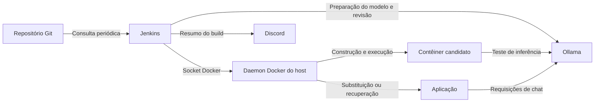

# Arquitetura e decisões da esteira

[README](../../README-pt-BR.md) · [English](../architecture.md) · Português (Brasil)

O [Jenkinsfile](../../Jenkinsfile) coordena testes, revisão consultiva e implantação de uma API Node.js. O [Compose](../../compose.yaml) executa Jenkins, Ollama e aplicação no mesmo host Docker.

## Serviços e comunicação

O Jenkins inclui Node.js 24 e as ferramentas cliente do Docker. Por meio de `/var/run/docker.sock`, constrói imagens e gerencia contêineres usando o daemon Docker do host.

Os serviços compartilham a rede padrão do projeto. Jenkins e aplicação acessam o Ollama em `http://ollama:11434`; o candidato temporário entra na mesma rede `<project>_default`. Jenkins e aplicação publicam, por padrão, as portas `8080` e `3000` em loopback. Ollama e candidato não publicam portas no host.

Volumes nomeados preservam os dados do Jenkins e os modelos baixados. O código da aplicação é copiado para a imagem. O perfil `app` separa a inicialização da aplicação da infraestrutura; a implantação seleciona esse serviço explicitamente. Consulte o [comportamento dos perfis do Compose](https://docs.docker.com/compose/how-tos/profiles/).

## Fluxo de execução

A primeira execução manual registra `pollSCM('H/5 * * * *')`. O Jenkins consulta a branch configurada a cada cinco minutos, com o minuto inicial definido para aquele job, e inicia um build quando encontra alterações. A branch é escolhida na configuração SCM do job. Consulte a [referência de gatilhos do Jenkins](https://www.jenkins.io/doc/book/pipeline/syntax/#triggers).

O Jenkins limpa o workspace, faz checkout do código e registra o commit atual e o do último build bem-sucedido. Define a tag `jenkins-ai-pipeline:<first-12-commit-characters>-<build-number>` e executa `npm run test:ci` para gerar relatórios JUnit e JSON. O código de saída dos testes fica salvo, permitindo preparar o modelo e solicitar a revisão mesmo após uma reprovação.

Em seguida, `npm run model:prepare` garante que o modelo escolhido esteja baixado, e `npm run review` solicita sugestões. O [guia de revisão por IA](ai-review.md) explica a seleção do código e os relatórios gerados.

Com os testes aprovados, `docker build` grava o commit completo em `APP_COMMIT` e constrói uma imagem que executa como usuário `node`. `npm run deploy` verifica saúde, commit e inferência real em um candidato temporário antes de substituir `app`. Repete as verificações após a troca e tenta restaurar a imagem anterior se a implantação falhar. Veja o procedimento em [implantação e recuperação](operations.md#implantação-e-recuperação).

Os builds desse job são sequenciais, e o Jenkins retém até 20 builds. A retenção de imagens Docker é tratada separadamente em [operação](operations.md#diagnóstico-e-manutenção).

## Resultado do build e condições para implantar

O resultado do build descreve a execução da esteira; o relatório de implantação identifica qual aplicação ficou em execução.

| Evento                                                   | Efeito na esteira e na aplicação                                                                                                             |
| -------------------------------------------------------- | -------------------------------------------------------------------------------------------------------------------------------------------- |
| Testes reprovados                                        | A preparação do modelo e a revisão ainda podem executar; construção e implantação ficam bloqueadas.                                          |
| Preparação do modelo ou revisão termina com erro         | O build fica `UNSTABLE`; as próximas etapas podem continuar. Um modelo indisponível em execução ainda pode reprovar os testes de inferência. |
| Revisão apresenta sugestões, inclusive de gravidade alta | As sugestões ficam registradas para avaliação humana; não alteram o resultado do build nem a permissão para implantar.                       |
| Falha na construção ou validação do candidato            | O build falha antes de substituir a aplicação.                                                                                               |
| Falha na implantação ou na validação final               | O build falha e a recuperação é tentada. Recuperar a aplicação não torna o build bem-sucedido.                                               |
| Erro comum na publicação do JUnit ou na notificação      | O build fica `UNSTABLE`, salvo se já estiver em estado mais grave; uma implantação existente não é desfeita.                                 |

Timeouts do Jenkins e cancelamentos manuais podem interromper esse fluxo. A seção de [limites de tempo](operations.md#limites-de-tempo) informa os valores e explica seu tratamento.

## Relatórios e notificações

O pós-processamento importa os resultados JUnit, envia uma notificação ao Discord e arquiva os arquivos disponíveis em `reports/**`. A [referência de artefatos](operations.md#artefatos-do-build) descreve cada relatório.

A mensagem do Discord inclui commit, URL do build, resultados dos testes e da implantação e um resumo da revisão com até três sugestões. O conteúdo é limitado a 2.000 caracteres, com menções desabilitadas. O [procedimento de notificação](operations.md#envio-de-notificações) detalha as tentativas e o estado do envio.

Continue em [configuração](setup.md), [revisão por IA](ai-review.md) ou [operação](operations.md).
